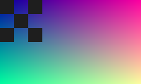
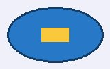
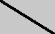

.Figura com título

[#fig-id.papel,align=center]

Imagem inline  e com alt  e com link .

Teclas kbd:[Ctrl+Shift+T], kbd:[F11] e botão btn:[OK].

Menu menu:Arquivo[Salvar como] e menu:Arquivo[] e menu:Editar[Preferências > Avançado].

Ícone icon:heart[] e icon:tags[alt=Marcadores].

<<<

'''

Depois das quebras.

video::filme.mp4[]

audio::som.mp3[]

Índice ((termo visível)) e (((oculto))) e indexterm:[outro oculto].

Fórmula stem:[x^2] e latexmath:[\frac{1}{2}].

